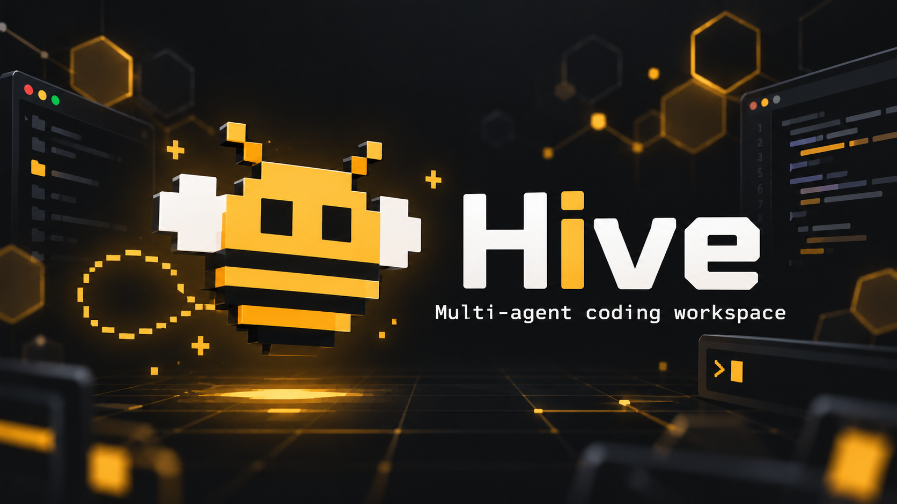
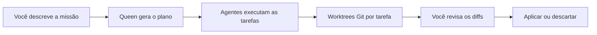

<div align="center">



# Hive

### Seu time de desenvolvimento com IA, em uma só colmeia.

Planeje missões, coordene agentes e revise cada entrega em um workspace desktop.


[Começar](#começar) · [Recursos](#recursos) · [Como funciona](#como-funciona) · [Mascote](#mascote) · [Contribuir](#contribuir)

</div>

---

O **Hive** é um aplicativo desktop para transformar objetivos de desenvolvimento em trabalho coordenado entre agentes de IA. A **Queen** divide uma missão em tarefas; agentes especializados executam o plano em worktrees Git próprias, respeitando as dependências entre as etapas.

Você acompanha a execução, abre o código, roda o projeto e revisa os diffs antes de aplicar as entregas na sua branch. Tudo no mesmo ambiente, com dados locais em SQLite e liberdade para escolher o provedor de IA.

> **Em desenvolvimento ativo.** O projeto já possui execução de missões, editor e integração Git. As instruções abaixo executam o aplicativo a partir do código-fonte; o build local não gera um instalador.

## Recursos

|                           | O que você pode fazer                                                                                                        |
| :------------------------ | :--------------------------------------------------------------------------------------------------------------------------- |
| 🐝 **Equipe de agentes**  | Configurar Queen, arquitetura, frontend, backend, QA, revisão e papéis personalizados, com modelos e ferramentas por agente. |
| 🧭 **Planejamento**       | Gerar planos com tarefas, dependências e critérios de aceitação; executar tarefas independentes em paralelo.                 |
| 🌿 **Isolamento com Git** | Trabalhar em branches e worktrees por tarefa, revisar resultados e escolher entre aplicar ou descartar.                      |
| 💻 **Editor integrado**   | Explorar arquivos, editar com Monaco, dividir o editor, buscar arquivos e inspecionar diffs.                                 |
| ✨ **IA no código**       | Pedir explicações, revisões e edições. As propostas aparecem como diff para aceitar no editor e salvar.                      |
| ▶️ **Terminal e preview** | Usar um terminal interativo, executar comandos e abrir endereços locais dentro do aplicativo.                                |
| 🎨 **Design Mode**        | Inspecionar elementos do preview local e transformar ajustes de estilo em propostas de código revisáveis.                    |
| 🌙 **Modo Turno**         | Enfileirar missões para planejar e executar em sequência, com tentativas configuráveis e entregas aguardando revisão.        |
| 📚 **Skills**             | Associar instruções e recursos aos agentes a partir de um catálogo de skills.                                                |
| 📊 **Controle**           | Acompanhar atividade e tokens, definir limites e configurar a aprovação de comandos.                                         |

## Como funciona



O scheduler respeita a ordem de dependência e o limite de tarefas simultâneas. O runtime nativo permite aos agentes ler, buscar e editar arquivos, consultar recursos de skills e executar comandos conforme a política de aprovação.

No **Modo Turno**, a fila avança sem aguardar aprovação manual do plano. As permissões de comandos dependem das configurações globais e da lista do turno. As entregas ficam disponíveis para revisão, sem aplicação automática no projeto.

## Começar

### Pré-requisitos

- **Node.js 24.x** e npm.
- **Git** disponível no terminal.
- Acesso à internet para a instalação inicial, que também baixa o Electron.

O fluxo documentado é voltado ao **Windows**. O script prepara o **pnpm 10.34.7** localmente; não é necessário instalá-lo globalmente.

```powershell
git clone https://github.com/VitorFalcochio/hive.git
cd hive
npm run setup
npm run dev
```

Você pode abrir o aplicativo e explorar a interface sem configurar uma API. Para planejar missões e usar os agentes, configure um provedor e um modelo acessíveis.

### Sua primeira missão

1. **Abra um repositório Git** com pelo menos um commit.
2. Em **Provedores**, configure a URL da API, salve a chave quando necessária e teste a conexão.
3. Em **Agentes**, use **Aplicar configuração recomendada** ou escolha os modelos manualmente. A recomendação testa os modelos com chamadas mínimas à API.
4. **Crie uma missão** e clique em **Gerar plano com a Queen**.
5. **Revise e execute o plano.** Acompanhe as tarefas e responda às solicitações de aprovação quando aparecerem.
6. **Revise as alterações** de cada tarefa. Use **Aplicar no projeto** para fazer o merge na sua branch ou **Descartar** para rejeitar a entrega.

Para aplicar uma entrega, o repositório precisa estar sem alterações não commitadas. As worktrees ficam fora do repositório aberto, em `.local/data/worktrees`, com branches `hive/…`.

As chamadas de recomendação, planejamento e execução podem consumir créditos do provedor escolhido.

### Executar o build local

```powershell
npm run build
npm start
```

## Provedores de IA

O runtime usa APIs compatíveis com **OpenAI Chat Completions**. O projeto inclui presets para:

| Categoria         | Provedores                                                                                  |
| :---------------- | :------------------------------------------------------------------------------------------ |
| APIs e gateways   | OpenAI, Google Gemini, NVIDIA, Groq, Cerebras, Mistral, DeepSeek, OpenRouter e Kilo Gateway |
| Servidores locais | Ollama, LM Studio e outros endpoints compatíveis                                            |

Cada agente pode ter seu próprio provedor e modelo. Servidores locais compatíveis podem funcionar sem chave; a disponibilidade de modelos, os limites e os custos dependem do serviço configurado.

## Código, execução e preview

- **Código:** explorador com status Git, abas, editor dividido, troca de branch e revisão de alterações. O salvamento detecta mudanças externas antes de sobrescrever arquivos.
- **IA no código:** selecione um trecho ou use o contexto do arquivo para conversar com um agente. Aceite uma proposta no editor e salve para gravar a edição.
- **Rodar:** mantenha sessões de terminal, pare ou reinicie comandos e abra URLs detectadas no Live Preview.
- **Design Mode:** no preview de um servidor local (`localhost` ou `127.0.0.1`), selecione um elemento para inspecionar texto, seletor, dimensões e estilos. Escolha o arquivo do componente e peça à IA uma proposta de edição.

| Atalho   | Ação               |
| :------- | :----------------- |
| `Ctrl+P` | Buscar arquivos    |
| `Ctrl+I` | Abrir IA no código |
| `Ctrl+\` | Dividir o editor   |
| `Ctrl+S` | Salvar o arquivo   |

## Dados e configurações

Os scripts mantêm os dados e caches em `.local/`, na unidade do projeto.

```text
.local/
├── data/
│   ├── hive.sqlite     # Repositórios, agentes, provedores, planos e configurações
│   └── worktrees/      # Áreas de trabalho das tarefas
├── electron-cache/
├── npm-cache/
├── pnpm-store/
├── tmp/
└── tools/             # pnpm local
```

A pasta é ignorada pelo Git. Preserve `.local/data` para manter os dados do aplicativo. Para escolher outro diretório de dados, defina `HIVE_DATA_DIR` antes de iniciar:

```powershell
$env:HIVE_DATA_DIR = "D:\HiveData"
npm run dev
```

As chaves de API são criptografadas com o `safeStorage` do Electron, usando o armazenamento do sistema operacional, e não são devolvidas à interface. Ao usar IA, o contexto necessário à tarefa é enviado ao endpoint configurado.

## Estrutura do projeto

Monorepo em **TypeScript**, gerenciado com **pnpm workspaces**.

```text
apps/
└── desktop/           # Electron, preload e interface React
packages/
├── agents/            # Runtime nativo e ferramentas dos agentes
├── core/              # Domínio, schemas, políticas e presets
├── orchestrator/      # Queen, scheduler e Modo Turno
├── persistence/       # SQLite e repositórios de dados
├── providers/         # Cliente de IA e catálogo de modelos
├── shared/            # Utilitários, caminhos, erros e segredos
├── skills/            # Leitura, adaptação e validação de skills
└── workspace/         # Repositórios, branches e worktrees Git
scripts/               # Bootstrap e execução local
```

A interface usa **React 19**, **Tailwind CSS 4**, **Monaco Editor**, **xterm.js** e **Zustand**. O aplicativo é construído com **electron-vite**; os testes usam **Vitest**.

## Mascote


A abelhinha em pixel art é desenhada em SVG pelo componente [`Mascot`](apps/desktop/src/renderer/src/mascot.tsx). O desenho é uma grade de pixels definida no próprio código, por isso não existe uma imagem PNG original do mascote.

- **Desenho e cores:** [`mascot.tsx`](apps/desktop/src/renderer/src/mascot.tsx).
- **Animações:** procure por `/* Mascot:` em [`styles.css`](apps/desktop/src/renderer/src/styles.css). As asas, os olhos e a flutuação têm animações próprias, com estados `idle` e `working`.
- **Onde aparece:** abertura do aplicativo, dashboard, estados vazios e indicador de tarefas em execução.
- **Versão para documentação:** [`docs/assets/mascot.svg`](docs/assets/mascot.svg), derivada da mesma grade de pixels.
- **Ícone do aplicativo:** [`apps/desktop/resources/icon.svg`](apps/desktop/resources/icon.svg), uma marca hexagonal diferente da abelhinha.

## Desenvolvimento

| Comando                | Função                                                       |
| :--------------------- | :----------------------------------------------------------- |
| `npm run setup`        | Preparar o pnpm local e instalar dependências com o lockfile |
| `npm run dev`          | Iniciar o aplicativo em desenvolvimento                      |
| `npm run build`        | Gerar o build do desktop                                     |
| `npm start`            | Executar o build local                                       |
| `npm run typecheck`    | Verificar os tipos dos pacotes                               |
| `npm test`             | Executar os testes                                           |
| `npm run test:watch`   | Executar os testes em modo watch                             |
| `npm run lint`         | Executar o ESLint                                            |
| `npm run format:check` | Conferir a formatação                                        |
| `npm run check`        | Executar lint, formatação, tipos e testes                    |

Os testes usam dados temporários e provedores simulados, sem chamadas pagas de IA.

## Contribuir

Abra uma [issue](https://github.com/VitorFalcochio/hive/issues) para relatar problemas ou discutir uma ideia. Para contribuir com código:

1. Crie um fork e uma branch para sua alteração.
2. Execute `npm run setup` e desenvolva a mudança.
3. Rode `npm run check` e `npm run build`.
4. Abra um pull request explicando a mudança e como foi verificada.

---

<div align="center">

**Uma missão. Vários agentes. Uma colmeia.**

</div>
